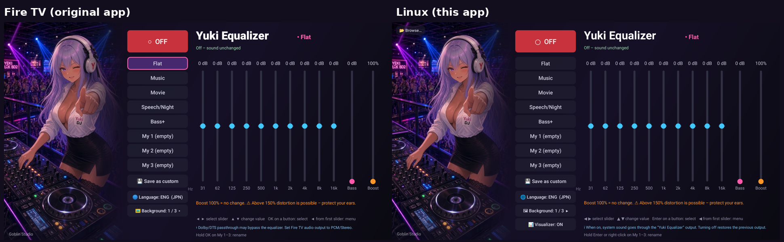
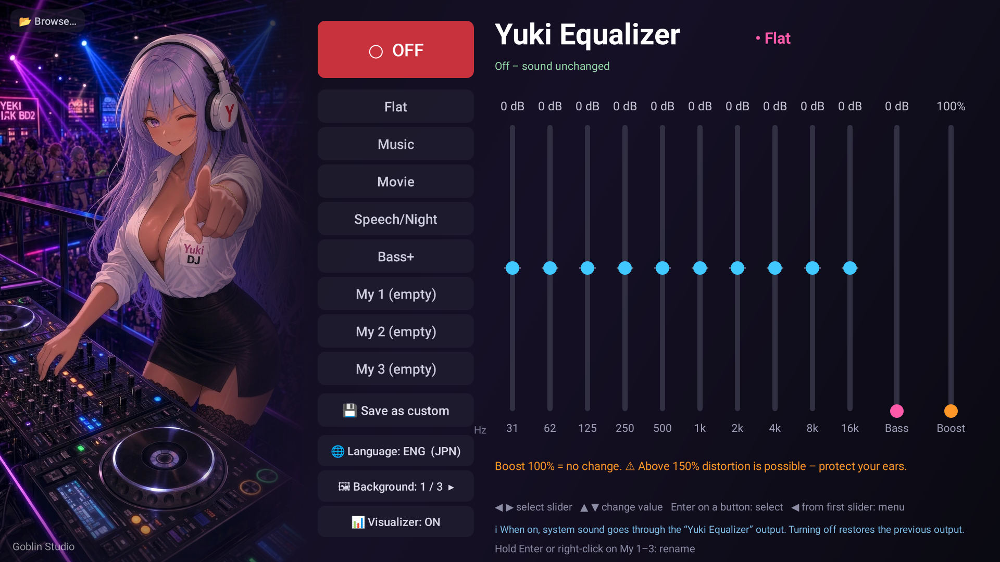
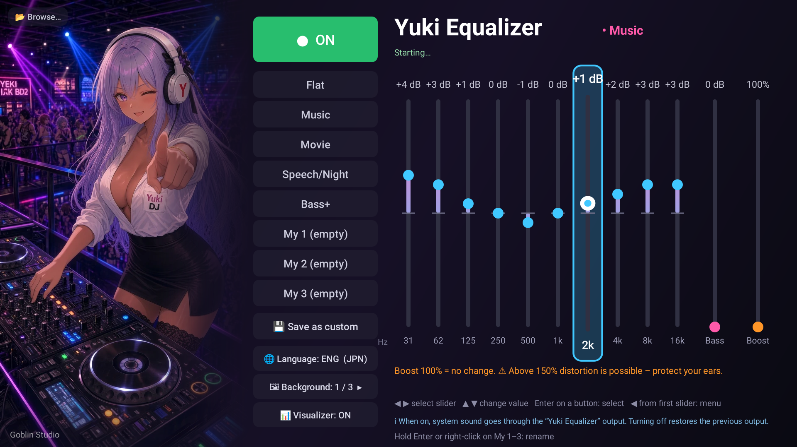
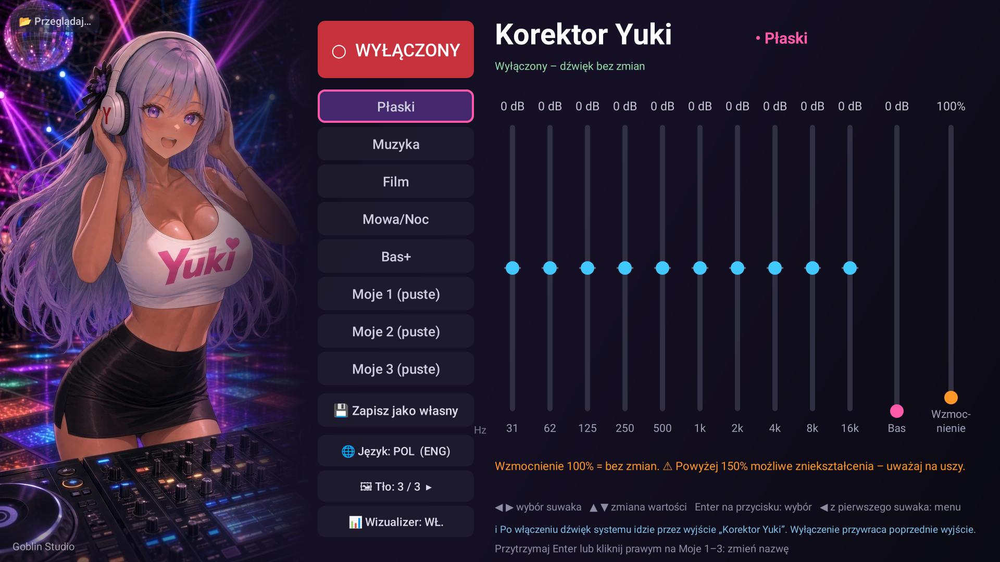
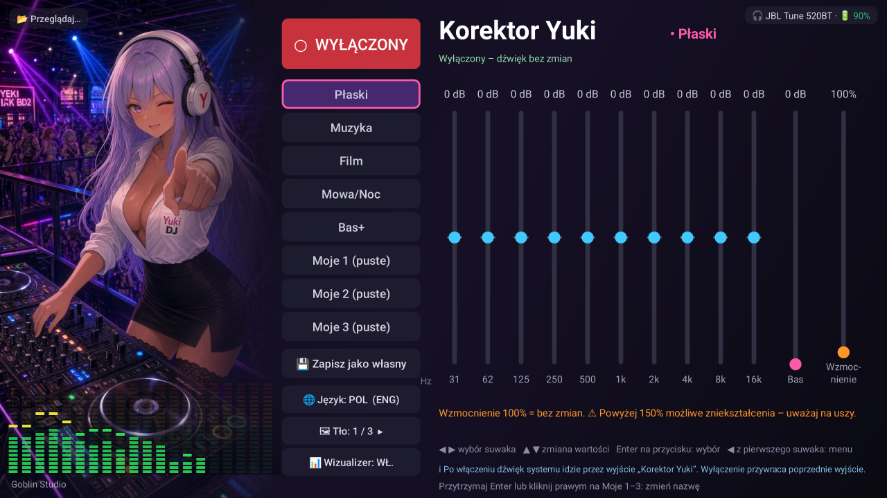

# Yuki Equalizer for Linux

A system-wide 10-band equalizer for Linux desktops running **PipeWire**, with the exact look of the
**Yuki Equalizer** app for Amazon Fire TV (by Goblin Studio). Everything you play — browser, Spotify, games,
video players — goes through the equalizer.



## Features

- **10 bands** (31 Hz – 16 kHz, octave spacing, ±12 dB) + **Bass** and **Boost** (100–200%) sliders
- Presets: **Flat, Music, Movie, Speech/Night, Bass+** and three of your own slots (**My 1–3**, renameable)
- **Speech/Night** preset uses a real compressor (4:1) like on Fire TV; a **limiter** at the end of the chain
  protects against clipping when Boost is above 100% (both optional, from `swh-plugins`)
- **LED visualizer** (20 bars) driven by what is actually playing — no microphone access
- **Bluetooth headphones pill** with battery level (read-only from BlueZ)
- **Your own picture**: replace the Yuki artwork with any JPG/PNG/WebP (*Browse… / Remove*); the original file
  is never moved or changed, a copy is stored in the settings folder
- 3 built-in backgrounds, UI in **English, Polish and Japanese** (picked from your system language,
  switchable in the app)
- Mouse and keyboard (arrow keys + Enter, like the Fire TV remote), **F11** = fullscreen
- Settings are remembered; optional **autostart** that turns the equalizer back on after login

| Main screen | Slider focused (keyboard) |
|---|---|
|  |  |
| **Japanese UI, background 2** | **Polish UI, background 3** |
|  |  |

Live window with the visualizer running (Polish UI):



## Requirements

| | |
|---|---|
| **Sound server** | PipeWire with `pipewire-pulse` (tested with PipeWire 1.0.5 + WirePlumber 0.4.17; 1.0 or newer recommended) |
| **Session** | A desktop session with systemd user services (`systemctl --user`). Tested on Linux Mint 22.3 XFCE (X11). Wayland should work through GTK 3 but has not been tested |
| **Python** | Python 3 (tested with 3.12.3) |
| **Libraries** | GTK 3 via PyGObject (tested GTK 3.24.41), pycairo (1.25.1), NumPy (1.26.4), Pillow (10.2.0) |
| **Tools** | `pactl`, `parec` (pulseaudio-utils), `pw-cli`, `pw-dump` (pipewire-bin), `systemd-run` |
| **Optional** | `swh-plugins` (LADSPA) for the Speech/Night compressor and the output limiter. Without it the equalizer works, just without those two |

**Measured resource use** (Intel Core i3-1215U laptop, 11 GiB RAM):

| Situation | CPU | RAM |
|---|---|---|
| Window open, visualizer running (30 fps) | ~10% of one core | ~100 MB |
| Dragging a slider with visualizer on | ~40% of one core | ~100 MB |
| Window closed, equalizer ON (only the PipeWire filter runs) | negligible | ~25 MB |

Any machine that can run a modern Linux desktop is enough.

## Dependencies

**Ubuntu / Linux Mint / Debian / Pop!_OS**

```bash
sudo apt install python3-gi python3-gi-cairo gir1.2-gtk-3.0 python3-numpy python3-pil python3-cairo \
                 pipewire-pulse pulseaudio-utils pipewire-bin
sudo apt install swh-plugins        # optional: compressor + limiter
```

**Fedora** (package names from the Fedora repos; the Ubuntu/Mint line above is the tested one)

```bash
sudo dnf install python3-gobject gtk3 python3-numpy python3-pillow python3-cairo \
                 pipewire-pulseaudio pulseaudio-utils pipewire-utils
sudo dnf install ladspa-swh-plugins  # optional
```

**Arch Linux / Manjaro** (not tested)

```bash
sudo pacman -S python-gobject gtk3 python-numpy python-pillow python-cairo pipewire-pulse libpulse pipewire
sudo pacman -S swh-plugins           # optional
```

Check that your system really uses PipeWire:

```bash
pactl info | grep "Server Name"      # should say: PulseAudio (on PipeWire 1.x.x)
```

## Installation

```bash
git clone https://github.com/SebMaliszewski/yuki-equalizer-linux.git
cd yuki-equalizer-linux
./install.sh              # add --autostart to restore the equalizer after login
```

The installer works per user (no root), and:

1. checks the dependencies; on apt-based systems it offers to install the missing ones with `sudo apt-get`
   (it asks first; `--yes` skips the question, `--no-deps` skips the check),
2. copies the app to `~/.local/share/yuki-equalizer/`,
3. adds a launcher `~/.local/bin/yuki-eq` and a menu entry **Yuki Equalizer** (Multimedia / Sound & Video),
4. with `--autostart`, adds `~/.config/autostart/yuki-equalizer-autostart.desktop`.

You can also run it without installing: `./yuki-eq` from the cloned folder.

## Uninstallation

```bash
~/.local/share/yuki-equalizer/uninstall.sh          # or ./uninstall.sh from the repo
~/.local/share/yuki-equalizer/uninstall.sh --purge  # also delete your settings
```

If the equalizer is on, the uninstaller first switches the sound back to your previous output and stops the filter.

## How it works

- **ON** starts a PipeWire *filter-chain* as a user service (`systemd-run --user --unit=yuki-equalizer`). It creates
  a virtual output called **“Yuki Equalizer”** (`yuki_equalizer`), sets it as the **default output**, and sends the
  processed sound on to the output you were using before (speakers, headphones, Bluetooth…). That output is remembered.
- **OFF** sets your previous output back as the default and stops the filter. Nothing else in your audio setup changes.
- **Closing the window does not stop the equalizer** — the sound keeps going through it until you press OFF.
- Slider changes are applied live (about 30 updates per second while dragging) without restarting the filter.
- Signal chain (per channel): Boost → low shelf (31 Hz band) → 8 × peaking filters (62 Hz – 8 kHz) → high shelf (16 kHz band) →
  compressor (Speech/Night only) → Bass low shelf (127 Hz) → stereo look-ahead limiter (−1 dB).
- With `--autostart`, after login the app runs headless (`yuki-eq --przywroc`): if the equalizer was **ON** when you
  shut down, it is switched on again (it waits up to 30 s for PipeWire and Bluetooth). If it was OFF, nothing happens.

## Usage

- **Mouse**: click buttons, drag sliders, scroll the wheel over a slider. Right-click **My 1–3** to rename.
- **Keyboard**: ◀ ▶ select a slider, ▲ ▼ change the value, Enter on a button selects it, ◀ from the first slider
  goes to the menu, hold Enter on **My 1–3** to rename. **F11** toggles fullscreen.
- **Save as custom** stores the current curve into a My slot.
- **Browse… / Remove** (top-left of the artwork) set or remove your own picture.
- Settings live in `~/.config/yuki-equalizer/` (`state.json`, generated `filter-chain.conf`, your picture).

## Troubleshooting

- **Emergency stop** (sound gone / something wrong):
  ```bash
  systemctl --user stop yuki-equalizer
  pactl list short sinks                 # find your real output
  pactl set-default-sink <your-output>   # set it back
  ```
- **No sound change when ON**: check that the default output is “Yuki Equalizer” (`pactl get-default-sink` →
  `yuki_equalizer`). Some apps are pinned to a specific device — move them in `pavucontrol`.
- **Visualizer shows nothing**: it reads the monitor of the default output with `parec`; make sure
  `pulseaudio-utils` is installed and something is playing.
- **Speech/Night has no compression / Boost clips**: install `swh-plugins`, then toggle OFF → ON.
- **App does not start**: run `yuki-eq` from a terminal to see the error; usually a missing `python3-gi-cairo` or
  `gir1.2-gtk-3.0`.
- **Filter logs**: `journalctl --user -u yuki-equalizer`.

## Privacy

- **No network access** at all, no telemetry, no accounts.
- **No microphone**: the visualizer analyses only the sound that is already playing (the output monitor), in memory;
  nothing is recorded or saved.
- Bluetooth is only read (device name + battery level) over D-Bus; nothing is changed.

## Differences from the Fire TV version

- Help texts at the bottom refer to keyboard/mouse and Linux instead of the remote and Dolby/Fire TV.
- The Speech/Night compressor threshold is −30 dB instead of −32 dB (the minimum of the `sc4m` plugin).
- No permission dialog for the visualizer (not needed on Linux).
- Extra: *Browse… / Remove* buttons for your own artwork.

## Project layout

```
yuki-eq             launcher script
yuki_equalizer.py   UI (GTK 3 + cairo, 1920×1080 canvas scaled to the window)
yuki_audio.py       PipeWire filter-chain, live parameter updates, ON/OFF
yuki_state.py       settings, presets, translations
assets/             artwork and icon
fonts/              Roboto (Apache 2.0)
install.sh / uninstall.sh
screenshots/
```

## License

MIT © 2026 Sebastian Maliszewski / Goblin Studio — see [LICENSE](LICENSE).
Roboto font: Apache License 2.0 (`fonts/LICENSE-Roboto-Apache2.txt`).
